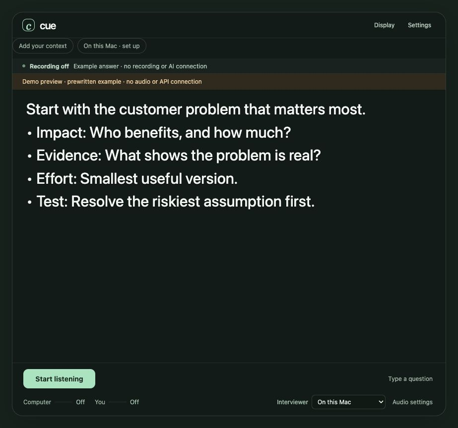
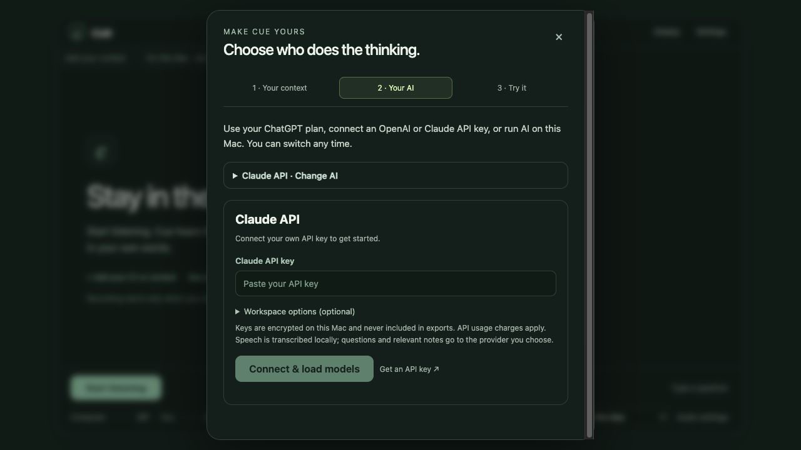

# Cue

A small, translucent desktop assistant that helps you stay in a conversation. Bring your own context, choose local AI, your own ChatGPT account, or an OpenAI/Claude API key, and get concise cues you can read at a glance.

A fresh installation starts with **no biography, saved account or previous user's notes**. Existing Cue users keep their own local account, notes and cache when upgrading. Use assistance where the participants or assessment rules permit it.



## Get started

Mac with Apple silicon, macOS 14.2 or newer. 16 GB memory is recommended; larger local models need more memory.

1. Get the Mac preview from [Releases](https://github.com/balabommablock-cpu/cue/releases). Move Cue.app to Applications.
2. Open **Your context** to add your CV or notes. Review what was imported before saving.
3. Open **Your AI**. Connect your own eligible ChatGPT account, use your **OpenAI API** or **Claude API** key, or choose **On this Mac** and download a local model once. API connections load available text models and also accept exact custom model IDs.
4. Try a typed question first. Then choose computer audio, microphone, or both and press **Start listening**. macOS asks for the relevant permissions.

The preview is ad-hoc signed, **not Apple notarized**. A new Mac may block opening it. Developer ID signing and notarization remain a release requirement for a smooth installation; this repository does not supply a signing identity.

## Make it yours

- **Display**: text size, background opacity, automatic or manual scrolling, scroll pace and always-on-top.
- **Reading presets**: Compact, Comfortable and Large text. Export a preference file and import it on another Mac. Preference files exclude context, accounts, API keys and microphone device identifiers.
- **Settings → Show me**: an opening thought with short cues, or a conversational script.
- **Your context**: edit or export your notes. Confirm stories before using them as personal evidence.
- **Your AI**: change accounts, API providers, local model size or answer model. Advanced settings retain Codex and OpenAI Realtime connections.

Cue normally keeps your data in `~/Library/Application Support/Cue`. An early Community-only installation continues using its existing `Cue Community` folder when no main Cue folder exists. Data is never copied from the developer’s computer into a release. Global launcher setup is optional: see [development](docs/DEVELOPMENT.md).

## AI choices

| Mode | What runs locally | What leaves the Mac |
| --- | --- | --- |
| On this Mac | Qwen3 answers and Whisper speech recognition | Model files are downloaded during setup; inference does not call a cloud model |
| ChatGPT | Speech recognition and context selection | Transcribed questions and relevant notes go to OpenAI through your own authorized account |
| OpenAI API | Speech recognition and context selection | Selected text and relevant notes go to OpenAI using your own API key |
| Claude API | Speech recognition and context selection | Selected text and relevant notes go to Anthropic using your own API key |
| Codex, advanced | Speech recognition and context selection | Selected text and reference facts go through your own installed Codex connection |
| OpenAI Realtime, advanced | Audio capture | Selected audio is sent to OpenAI using an API key you provide |

Local models are less capable than leading cloud models. Calculations and personal questions can take longer. There is no sub-second guarantee. ChatGPT plan access is subject to eligibility and the account's current limits; it does not read ChatGPT chat history. AI coaching and practice feedback currently require Codex.

## API keys and model selection



In **Your AI**, choose OpenAI API or Claude API, paste your key, then press **Connect & load models**. Select a model from the suggestions or enter the exact ID of a compatible text model, including a fine-tuned model. There is no fixed API-model shortlist. Your provider must grant the key access and sufficient API credit.

Keys are encrypted with macOS-protected storage, kept in the native main process after entry, and never returned to the UI. Replace or remove a key in the same panel. Claude keys that span workspaces may need the optional workspace ID. Claude subscription/Claude Code OAuth tokens are not accepted as Console API keys.

OpenAI uses Responses, with Chat Completions compatibility for older text models. Claude uses the Messages API. Only answer text is displayed; thinking events are ignored. Failed or truncated streams are reported, and cancellation stops the local request.

Protocol references: [OpenAI models](https://developers.openai.com/api/reference/resources/models/methods/list), [OpenAI streaming](https://developers.openai.com/api/docs/guides/streaming-responses), [Claude authentication](https://platform.claude.com/docs/en/manage-claude/authentication), [Claude models](https://platform.claude.com/docs/en/api/models/list), [Claude streaming](https://platform.claude.com/docs/en/build-with-claude/streaming).

## Screen sharing

**Cue cannot promise universal invisibility or undetectability.** The overlay is a normal desktop process. OS versions, sharing modes, recordings and meeting software can capture it.

The optional **Share View** creates a presentation window whose source stream excludes Cue. Select **Cue Share View — share this window** in the meeting's window picker. Independently sharing the whole display can expose Cue. Check the receiving participant's picture before relying on a setup.

[Capture boundaries and a reproducible test](docs/SCREEN_SHARING.md) explain what this feature does and what remains unverified. This project does not defeat proctoring, OS security, process inspection or browser restrictions.

## Build from source

Requires Node.js 22.12+ and npm. Native packaging requires macOS and Xcode Command Line Tools.

```sh
git clone https://github.com/balabommablock-cpu/cue.git
cd cue
npm ci
npm run build
npm test
npm run dev
```

Close other Cue copies using port 4329 before starting the desktop app. For a browser-only UI preview, `PORT=4358 npm start` serves the interface locally; native account sign-in and Share View need the desktop app.

```sh
npm run audit:public
npm run package
```

The package is created under `dist/share/`. It contains an empty profile, bundled runtime assets, native helpers and third-party notices. Model weights download separately. [Architecture and contribution guide](docs/DEVELOPMENT.md).

[Release validation and remaining limits](docs/VALIDATION.md).

## Security and ownership

Account tokens and saved API keys are encrypted through Electron safeStorage and stay in the native main process. The renderer receives status and answer text. API keys entered in Realtime settings are session-only. The local server binds to loopback, rejects foreign request origins and serves an explicit asset allowlist.

The repository has a fresh history, a Gitleaks scan and a separate public-source audit. Runtime data, environment files, credentials, signing keys, local workspaces, private research and deployment-owner secrets are excluded. See [SECURITY.md](SECURITY.md) before reporting a vulnerability.

MIT-licensed application code. Dependencies and model weights retain their own licenses; see [third-party notices](THIRD_PARTY_NOTICES.md).
